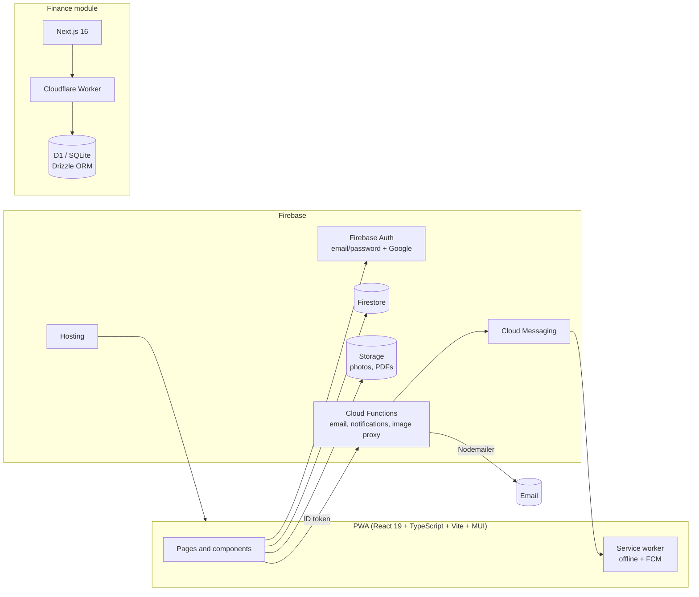

# FireSafe: case study

> **The source code is private** (client project). This repository documents the product, the architecture and the decisions behind it. Screenshots use demo data.

FireSafe is a Progressive Web App I built on my own, as a paid freelance project, for **Firecorp**, a Brazilian fire-safety consultancy (assessoria em segurança contra incêndio). It replaced the company's Excel spreadsheet for tracking fire-safety permits (*alvarás*) and licensing processes. Firecorp authorized this case study.

## The problem

Firecorp tracked its clients' properties, permits and licensing processes in a large spreadsheet:

- no automatic warning before a permit expired
- no shared, multi-device view for the team
- photos, documents and process steps kept outside a single system

## What I built

**Core product**
- **Proposals → properties:** an accepted proposal automatically creates the property record
- **Properties** with inspections (with photos), PDF documents, configurable process steps and notes
- **Permit status computed automatically** from the validity date: *Regular*, *Irregular* or *Sem Alvará* (no permit)
- **Configurable expiry alert** (default 60 days) that flags properties needing a new inspection
- **Compliance dashboard** with charts (Recharts), a table view with CSV export, and spreadsheet import
- **Collaborators and roles:** Admin, Technician, Manager, Viewer; groups assigned to people and properties
- **Email notifications** for irregular permits and **push notifications** (FCM)
- Rich-text editing (TipTap), PDF generation (jsPDF), QR codes

**Finance module** (built separately, now being integrated)
- Cash flow, management income statement (DRE), income/expense entries
- CSV and OFX bank statement import (Cora, Sicoob, C6 Bank), CSV export
- Alerts for inconsistent dates and possible duplicates; internal transfers kept out of the DRE

## Architecture

## Key decisions

- **From localStorage to Firebase.** The first version stored everything in the browser, so data lived on one device only, auth was simulated and photos were base64 strings. I migrated it to Firebase Auth, Firestore and Storage so the team shares one source of truth across Android, iPhone and Windows.
- **Inspections as a Firestore subcollection.** Documents are capped at 1 MB, and a property accumulates inspections over the years. Keeping inspections in a subcollection (with photos as Storage URLs, not base64) keeps property documents small and lets the app load only recent inspections.
- **Secrets stay server-side.** Email sending runs in a Cloud Function that verifies the caller's Firebase ID token and reads SMTP credentials from Functions secrets, never from the client.
- **PWA instead of native apps.** One codebase installs on Android, iOS (via Safari) and Windows, works offline and receives push notifications.
- **Computed, not stored, permit status.** The status is derived from the validity date at render time, so it is never stale.

## Stack

`React 19` `TypeScript` `Vite` `MUI` `Recharts` `TipTap` `jsPDF` `xlsx` `Firebase Auth` `Firestore` `Storage` `Cloud Functions` `FCM` `Firebase Hosting` `PWA` `Next.js 16` `Cloudflare Workers` `D1` `Drizzle ORM`

Built with **Claude Code** as part of my daily workflow.

## Screenshots

*Coming soon (demo data).*

---

**Lucas Bragança Gonçalves** · [Portfolio](https://lucasbragancadev.vercel.app) · [LinkedIn](https://www.linkedin.com/in/lucas-braganca-goncalves98)

### Resumo em português
O FireSafe é um PWA que construí sozinho, como freelancer, para a Firecorp, uma assessoria em segurança contra incêndio. Ele substituiu a planilha Excel de controle de alvarás e processos de licenciamento, com backend em Firebase (Auth, Firestore, Storage, Cloud Functions, FCM) e um módulo financeiro em Cloudflare Workers. O código é privado; este repositório documenta o produto e a arquitetura.
